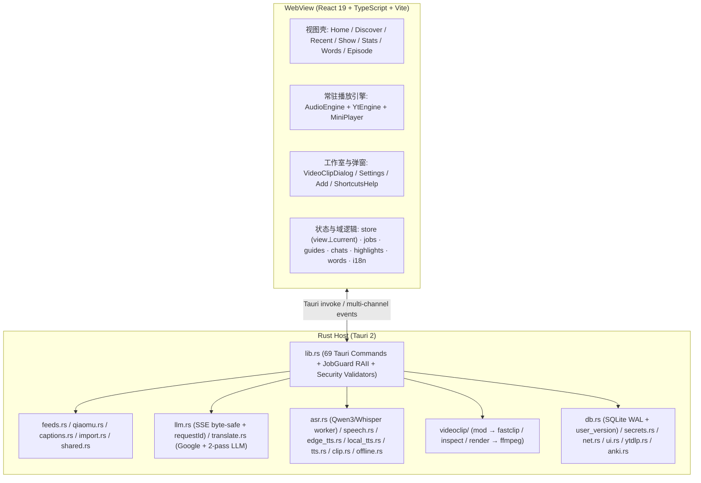

# 系统架构 · Subpodcast 声译

## 1. 整体分层

## 2. 关键架构决策

1. **网络全在 Rust**：所有外部请求统一走 `net.rs`（解决 WebView CORS 与统一代理；设置代理优先，留空直连，仅连接类错误按需回退系统代理，保留真实 HTTP 状态码）。
2. **播放与浏览正交（`view ⊥ current`）**：`store.ts` 将导航 `view` 与播放 `current` 分离；`AudioEngine` 与 `YtEngine` 常驻根部并经 `audioHost`/`ytHost` 互斥停声；单集内所有时间戳点击经 `playback.seekEpisode` 按集校验，防止跨集误跳。
3. **发行版内嵌本地 UI 服务（`ui.rs`）**：YouTube IFrame 拒绝 `tauri://` origin，发行版由 `ui.rs` 绑定 loopback `14427–14446` 提供打包资产，校验 `Host` 头并附加安全头；全部端口被占时显式报错拒绝回退。
4. **多通道流式事件与可取消任务**：
   - `llm-delta` 携带 `{ requestId, delta }`，导读与问答可并发流式生成互不阻塞。
   - Rust 后端通过 `JobGuard`（RAII `Drop` + `Arc::ptr_eq`）管理长任务取消，防止旧任务误删新任务标志或异常泄漏。
5. **Whisper 原生隔离与本地 TTS 校验**：
   - `whisper-rs` 通过 `--asr-worker` 子进程隔离 C++/Metal 崩溃风险。
   - `local_tts.rs` 对运行时与模型文件执行固定版本 SHA-256 / Git-blob 校验。
6. **长列表虚拟化**：`TranscriptPane`（千句级字幕）与 `ShowView`（万集级目录）均采用 `@tanstack/react-virtual` 动态高度虚拟滚动。

## 3. 安全模型

- **CSP 与 HTML 清洗**：`tauri.conf.json` 开启显式 CSP 白名单；远端精读 HTML 在前端经 `DOMPurify` 清洗，所有外部链接经 `safeUrl.ts` 校验 `http(s)`。
- **IPC 边界**：
  - `llm_chat` / `translate_batch` / `cloud_transcribe` / `list_models` 从已持久化 `settings` 解析 `baseUrl` 并强制 `https://`（本机回环除外）。
  - `reveal_file` 对 macOS `.app`/`.pkg`/`.dmg` 等 Bundle 强制只定位不执行；`export_anki` 仅允许打包 `<data>/clips/` 内音频；`save_text` / `save_download` 校验扩展名白名单；`file_exists` 限制在应用数据/下载/导出目录内。
- **密钥存储**：正式 Developer ID 签名包写入系统钥匙串；开发/ad-hoc 构建写入 `0o600` 创建的本机 `secrets.json`。

## 4. 数据持久化（SQLite WAL）

- 表：`shows` · `episodes`（含 `deep`、`heard_at` 及 `episodes_show` / `episodes_heard` / `episodes_pub` 索引）· `transcripts` · `blobs` · `settings` · `tr_cache` · `listens`。
- Schema 通过 `PRAGMA user_version` 进行演进迁移；`sync_episodes` 与 `delete_show` 均包入事务保证原子性，`absorb_episode` 同步合并 `listens` 统计。
